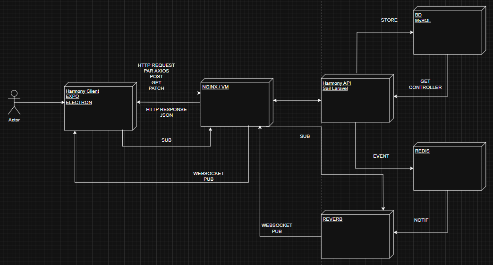

# Harmony API

## OBJECTIF
Cette API alimente l’application de chat Harmony, avec des endpoints pour la gestion des utilisateurs, des messages, 
des fonctionnalités temps réel et permet d'avoir de la persistance de données sans utiliser des sessions.

## STACK TECHNIQUE
- PHP 8.2+
- Laravel 12
- MySQL
- Redis
- Laravel Reverb (broadcast)
- Laravel Sanctum (authentification)
- Docker (pour le développement local)

## PRÉREQUIS
- Docker & Docker Compose
- Composer
- Git

## INSTALLATION LOCALE
1. Cloner le dépôt : https://github.com/Poro007/multiplateforme-harmony-API.git
2. Ouvrir le projet dans un IDE (ex: VSCode, PHPStorm, ECT)
3. Ouvrir un terminal dans l'IDE et faire un `npm install`
4. Copier le fichier d’environnement et le configurer (.env). (prendre celui dans le .env.exemple)
5. faire ``composer install`` dans wsl ou avec la commande docker ci-dessous :
6. Ouvrir un terminal wsl et installer les dépendances avec `docker run --rm \-u "$(id -u):$(id -g)" \-v "$(pwd):/var/www/html" \-w /var/www/html \
laravelsail/php84-composer:latest \
composer install --ignore-platform-reqs`
6. Démarrer Docker.
7. Démarrer les conteneurs Docker dans wsl avec `sail up -d --build` ou `./vendor/bin/sail up -d --build`
8. faire la commande : `docker compose exec app php artisan migrate`
8. Lancer les migrations et les seeders dans wsl avec `docker compose exec app php artisan migrate:fresh --seed --force`

## UTILISATION
- L’API est disponible sur `https://definitelynotharmony.dev/api`.
- L’authentification se fait via Laravel Sanctum.
- Endpoints principaux :
    - `GET /api/salons` — Liste des salons
    - `PATCH /api/user` — Modifier les préférences utilisateur (langue, mode sombre)
    - `GET /api/salons_members/{salons}/notmembers` — Récupérer les utilisateurs non membres d’un salon
    - `POST /api/salons_members/salons/members` — Ajouter un utilisateur à un salon
    - `DELETE /api/salons_members/salons/members` — Retirer un utilisateur d’un salon

## TESTS
 - Les tests sont fait avec postman surtout. Par la suite, ils sont fait directement avec le client.

## LIMITATIONS & AMÉLIORATIONS FUTURES
- Certains endpoints sont lents : optimisation prévue.
- Ajouter des tests unitaires et d’intégration (maybe).

## UML

## DETTE TECHNIQUE

## AUTEURS
- Eddi Rousseau
- Alex Heroux
- Maxime Nobert
- Tommy Desjardins
